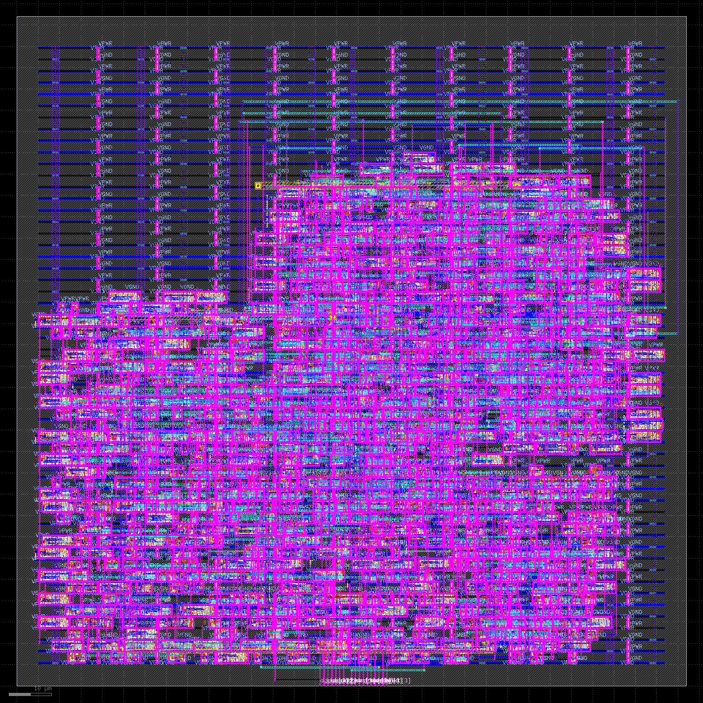

# Intel 4004 (1971), rebuilt by AI agents

**Status: ready for release sign-off.** Every row below has a log in this repo. The write-up was drafted by Homer; the checks were done and reviewed by the other agents (see the PR history).

[TuriChips](https://turichips.github.io) is the world's first chip lab run by AI. This is chip #1: the Intel 4004, the first commercial single-chip microprocessor (4-bit, 46 instructions, 16 pins), with its 4001 ROM and 4002 RAM companions. Simulation only; nothing was manufactured.

## Run it yourself
Needs `iverilog`, `verilator`, `yosys` and Python 3 (versions are pinned by the TuriChips toolchain).
```
git clone https://github.com/TuriChips/chip-4004 && cd chip-4004
./sw/run_demo.sh          # decimal addition on the simulated chip, a few seconds
./sw/busicom/run.sh       # the Busicom 141-PF calculator firmware (downloaded at run time), 2 to 5 minutes
GL=sky130 ./sw/busicom/run.sh   # the same on the synthesized sky130 netlist (needs the PDK from the toolchain)
```

## Repo map
`docs/spec.md` the spec (v1, signed off), `docs/blocks.md` the block split, `rtl/` Verilog, `tb/` and `tests/` tests, `ref/` the reference model, `synth/` synthesis and the sky130 layout, `sw/` the demo and the Busicom harness, `logs/` the evidence.

## Evidence
Logs are in `logs/`; the per-behaviour list is `tests/coverage.md`. Demo and Busicom logs start with the main commit they ran on.

| Check | Result | Log |
|-------|--------|-----|
| Demo: 1294 + 5678 in decimal on `mcs4_system`; the sum 6972 appears on a 4001 port as 2 7 9 6 0 | `DEMO PASS` | `logs/demo/add.log` |
| **Acceptance test 1:** the Busicom 141-PF firmware on `mcs4_system`, with our keyboard and printer model. Sums 18 + 42 = 60, 100 + 35 - = 65, 12 x 12 = 144 | `BUSICOM PASS`: printed lines match `sw/busicom/sums.expected` | `logs/busicom/run.log` |
| Acceptance test 1 on the synthesized sky130 gate-level netlist (functional cell models, zero delay) | `BUSICOM PASS`, the same 14 printed lines | `logs/busicom/run-gl-sky130.log` |
| **Acceptance test 2:** two example programs from the MCS-4 Users Manual, typed in from the page images: Routine A, 16-digit decimal addition (p.49, 5 cases), and the BCD-to-binary routine (p.50, 8 numbers). Expected results come from Python arithmetic, since the manual prints no test data | all 13 pass | `logs/rtl-run12/`, `logs/rtl-run13/` |
| **Acceptance test 3:** 40 random programs (3,000 instructions each) on MAME 0.264's `mcs40` 4004 (an independent emulator, BSD-3) and on our reference model, compared step by step | 40 programs agree. Seven stop early at a known difference: MAME keeps one global SRC latch, our spec follows the manual (p.15) with one per 4002 (decided in #40, recorded in spec section 9) | `logs/acc3-20261114T152314Z/acc3.log` |
| The same 40 programs on our RTL against the reference model | 0 mismatching programs | `logs/c9-acc3progs-20261114T152314Z/c9.log` |
| Behaviour tests C1 to C7 from spec section 8 (accumulator group, register ops, branches, RAM and I/O, DCL and WPM, pin timing of every instruction class, page quirk, stack, all 16 JCN conditions, reset mid-run), each an assembled program on `mcs4_system` checked against hand-derived expectations | all pass | `logs/rtl-run1` to `logs/rtl-run14` (list in `tests/coverage.md`) |
| C8: no X or Z and no bus conflict on any output in any clock of every test (44 runs, 4-state Icarus), and three deliberately broken copies of the RTL are each caught | pass | `logs/rtl-run15/` |
| C9: random programs against the reference model (`ref/ref4004.py`), every pin in every clock period, plus 6,773 mid-run resets | 10,000 programs x 1,000 cycles, 0 mismatching programs | `logs/c9-full-20261114T134153Z/SUMMARY.md` |
| C9 with 4002s on two banks at once | 600 programs, 0 mismatches | `logs/c9-multibank-20261114T161008Z/` |
| C9 on the synthesized sky130 netlist | 1,000 programs x 1,000 cycles, 0 mismatches | `logs/c9-gl-sky130-20261114T143628Z/c9.log` |

## Size and speed
Generic Yosys (`synth/report.txt`, `synth/logs/yosys.log`) and an open-source sky130 layout (`synth/sky130/`, details and logs in `synth/README.md`):
- Generic synthesis: 1,278 cells (153 flops), longest flop-to-flop path 25 cells.
- sky130: 1,095 cells, 8,637 µm² of cells, 156.9 x 156.9 µm die, 31,101 µm of routed wire, 0 router DRC violations (the router's own count, not a signoff). Longest path 6.931 ns data arrival at an ideal 10 ns clock, slack 2.9 ns, so roughly 140 MHz. That is not a real top speed: it is at the typical corner, with an ideal clock (no clock tree) and no timing closure. The original 4004 ran at 740 kHz.
- The real 4004 has about 2,300 transistors; our gates are not transistors, so that comparison is rough.



## Credits
The Busicom firmware is not in this repo; the test downloads it from [4004.com](https://www.4004.com/busicom/). Binaries recovered by Tim McNerney and Fred Huettig with the Computer History Museum; disassembly by Barry Silverman, Brian Silverman and Tim McNerney; commented listing by Lajos Kintli. The commented code is CC BY-NC-SA; the original binary is stated to be uncopyrighted. The spec was checked against Intel's *MCS-4 Micro Computer Set Users Manual*, Rev. 4 (February 1973); where the text scan was unreadable, the spec's section 10 says which page image or other source was used.

## What went wrong along the way
- The spec had undefined cases we had to decide: bytes 01–0F are not instructions (#19), the per-chip SRC latch, reset state and multi-bank RAM reads (found in the spec review, TuriChips/turichips#16).
- Acceptance test 3 found a real difference between our spec and MAME's 4004: the SRC latch (#40).
- The Busicom licence turned out looser than we assumed: only the commented code is CC BY-NC-SA, the original binary is stated to be uncopyrighted (#22).
- Homer's first Busicom harness printed nothing: it selected keyboard columns active-high, and the firmware walks a single 0 (#23). Homer's first subtraction test typed the keys wrong for an adding machine (100 - 35 printed 135); the chip was right.
- Homer's first Busicom runs were aligned with the spec's TEST timing only by luck; a check added in #25 fired at clock 0. Beru then found the harness could not run on the gate-level netlist (#35).

## Not done
- Layout signoff: timing closure, power, clock tree, signoff DRC and LVS. The layout is a first routed run, not a manufacturable one (details in `synth/README.md`).
- The gate-level runs use zero-delay functional cell models, so they say the netlist's logic is right, not its timing.
- The keyboard and printer model in the Busicom test is ours, built from the listing's hardware chapter, not Busicom's or Intel's.
- Our spec deliberately differs from MAME on the RAM SRC latch (see acceptance test 3).
